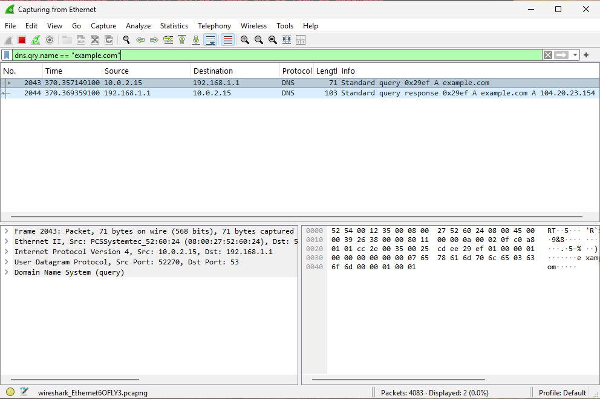
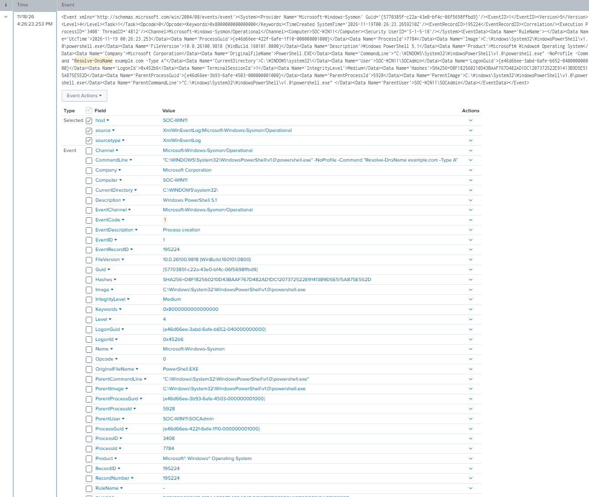
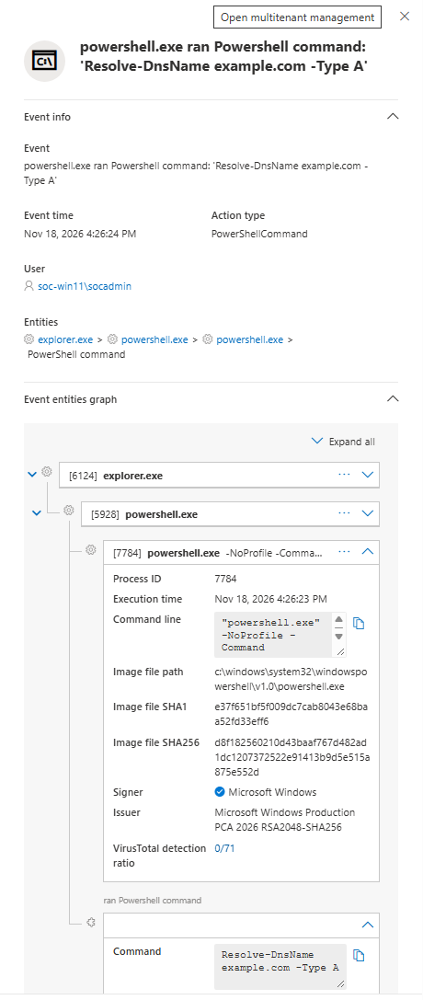
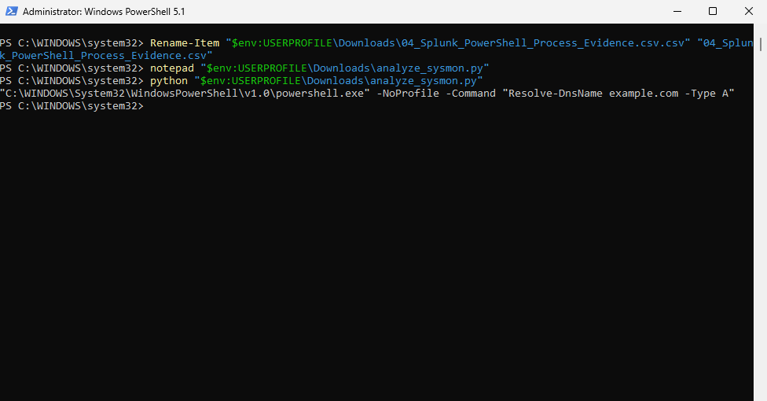
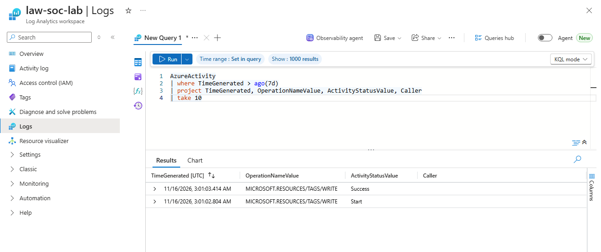
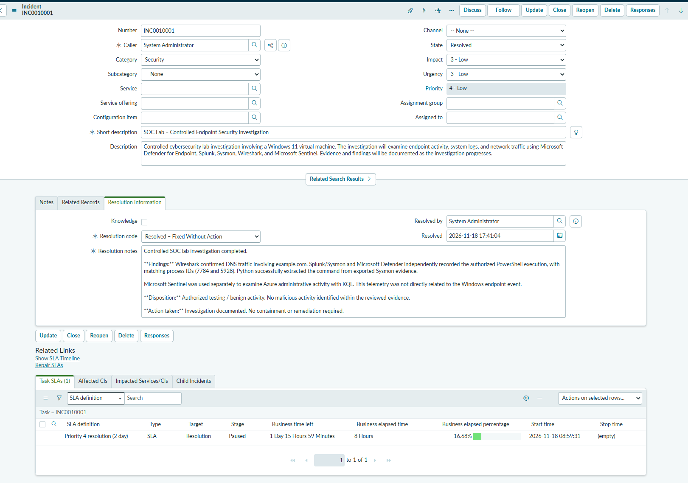

# SOC Lab 01 — Multi-Source Security Investigation

## Project Overview

This project demonstrates a controlled cybersecurity investigation using multiple security monitoring and analysis tools. The objective was to generate authorized endpoint activity, collect supporting evidence, correlate security telemetry, and document the investigation through incident resolution.

**Environment:** Windows 11 virtual machine (`SOC-WIN11`) running in VirtualBox.

## Tools Used

- **Splunk & Sysmon:** Windows process-event collection and log analysis.
- **Microsoft Defender for Endpoint:** Endpoint activity and process-tree investigation.
- **Wireshark:** DNS packet capture and traffic analysis.
- **Python:** Basic CSV log parsing and extraction.
- **Microsoft Sentinel:** KQL analysis of Azure administrative activity.
- **ServiceNow:** Incident tracking, investigation notes, and resolution.

## Investigation Summary

A PowerShell command was executed in an authorized lab environment to perform a DNS lookup for `example.com`.

The investigation included:

1. Capturing the DNS query and response in Wireshark.
2. Identifying the PowerShell process creation event in Splunk using Sysmon Event ID 1.
3. Verifying the corresponding process activity in Microsoft Defender for Endpoint.
4. Exporting Splunk evidence and using Python to extract command-line information.
5. Independently querying Azure administrative activity in Microsoft Sentinel using KQL.
6. Documenting the investigation in ServiceNow incident `INC0010001` and resolving it.

## Findings and Outcome

The reviewed evidence was consistent with the authorized DNS lookup. No malicious activity was identified in the examined events, and no containment or remediation was required.

**Investigation disposition:** Benign / Authorized Testing.

## Important Limitations

Microsoft Sentinel was used for a separate Azure audit-log analysis exercise. It was not connected to the Windows endpoint investigation, and no direct endpoint correlation is claimed.

Sysmon DNS query event logging (Event ID 22) was not enabled. Process evidence was obtained from Sysmon Event ID 1, while DNS traffic was independently verified in Wireshark.

## Project Evidence

The repository includes:

- Six `.png` screenshots — Investigation evidence and ServiceNow resolution.
- `04_Splunk_PowerShell_Process_Evidence.csv` — Exported Sysmon process evidence.
- `analyze_sysmon.py` — Python script used to analyze the CSV.

Raw evidence and screenshots must be reviewed for sensitive information before public release.

## Investigation Evidence and Screenshots

### 1. Wireshark — DNS Traffic Analysis

Captured the DNS query and response for `example.com`, confirming communication between the Windows 11 lab endpoint and its DNS server.

### 2. Splunk — Sysmon Process Investigation

Investigated Sysmon Event ID 1 to identify the PowerShell process, command-line arguments, and parent process information.

### 3. Microsoft Defender — Endpoint Investigation

Verified the same PowerShell execution through Microsoft Defender for Endpoint. Correlated process ID 7784 and parent process ID 5928 with the Splunk evidence.

### 4. Python — Security Log Analysis

Developed and executed a Python script to parse exported Splunk CSV evidence and extract the PowerShell command line.

### 5. Microsoft Sentinel — KQL Log Analysis

Used Kusto Query Language (KQL) to examine Azure administrative activity. This was a separate cloud audit-log exercise, not a direct correlation with the Windows endpoint event.

### 6. ServiceNow — Incident Resolution

Documented the investigation, recorded supporting evidence, assessed the activity as authorized testing, and resolved incident INC0010001 without requiring containment or remediation.

## Skills Demonstrated

Security event investigation, SPL searching, KQL querying, process-tree analysis, DNS traffic inspection, Python CSV parsing, evidence documentation, and incident case management.
